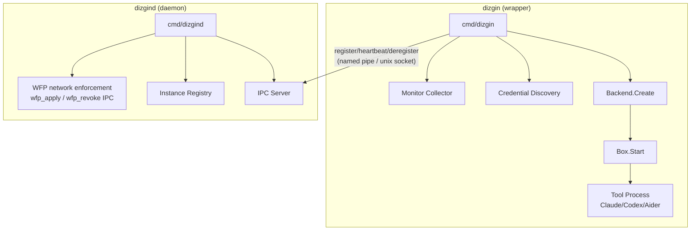
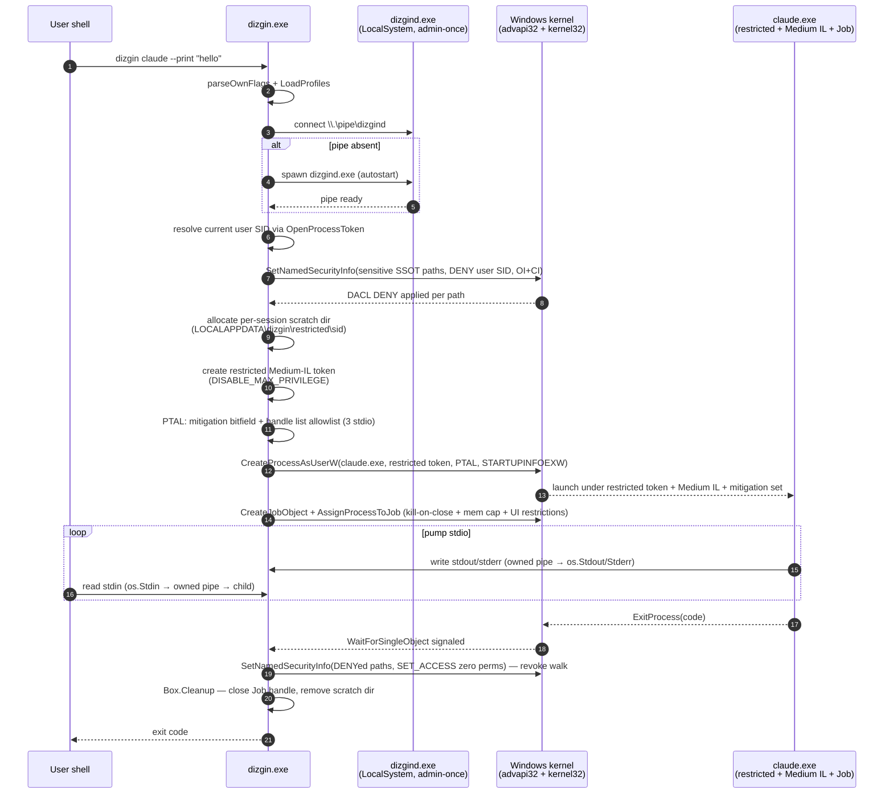
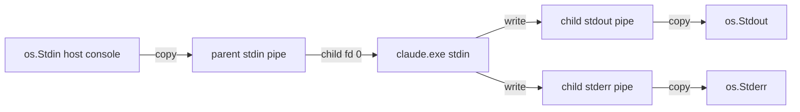

# Architecture

## System Overview



## Data Flow

```mermaid
sequenceDiagram
    participant User
    participant dizgin
    participant Backend
    participant Box
    participant Tool
    participant Daemon

    User->>dizgin: dizgin claude
    dizgin->>dizgin: Load config, discover credentials
    dizgin->>Backend: Create(ctx, cfg, opts)
    Backend->>Box: Allocate sandbox (restricted/Seatbelt/bwrap)
    dizgin->>Box: Start(ctx, cmd, args, env)
    Box->>Tool: CreateProcessAsUserW / exec
    dizgin->>Daemon: Register (IPC)
    loop Every 10s
        dizgin->>dizgin: Collect metrics (Job Object / /proc)
        dizgin->>Daemon: Heartbeat + metrics
    end
    Tool-->>Box: Exit
    Box-->>dizgin: Wait() returns exit code
    dizgin->>Daemon: Deregister
    dizgin->>Box: Cleanup() — revoke DACL DENY, free Job, remove scratch
```

## Sandbox Backends

| Platform | Backend | Isolation | Network | Resources |
|----------|---------|-----------|---------|-----------|
| Windows | Restricted token + Medium IL + Job + per-child Mitigation Policy + DACL DENY on 19 sensitive SSOT paths | Privilege drop, IL drop, DEP/ASLR/ImageLoad hardening, DACL DENY on credential paths | User-mode WFP allowlist (brokered by elevated dizgind daemon via `wfp_apply`/`wfp_revoke` IPC); `DIZGIN_NO_WFP=1` reverts to advisory; kernel callout driver is ROADMAP #1 | Job Object memory/PID limits |
| macOS | Seatbelt | sandbox-exec SBPL (kernel-MAC), R1 credential-deny overlay | Per-IP-resolved allowlist (SBPL matches IPs, not hostnames); DNS/loopback stay open | rlimit |
| Linux | bubblewrap | User namespaces + seccomp-BPF, R1 cover-mounts | `allowlist` not yet enforced — `Create()` rejects it; `blocked`/`open` only | cgroups / rlimit |

All backends implement `sandbox.Backend` + `sandbox.Box` interfaces. Registration via `init()` + build tags ensures exactly one backend per binary — no platform-level fallback chain.

## Transparency Model

The sandbox is designed to be invisible to the tool:

- **Paths**: `Mount.Host == Mount.Guest` on every platform — no remapping, no virtual home, no path translation. The tool sees the same absolute paths the host sees.
- **Environment**: Full `os.Environ()` passthrough + credential injection. User-profile env vars (USERPROFILE, HOME, APPDATA, LOCALAPPDATA, TEMP, TMP) are forwarded as-is. The exception is iter5 L1 per-session TEMP redirect (`TEMP`/`TMP`/`TMPDIR` → scratch dir) which keeps Bun-class self-extracting runtimes from leaking into the host's `%TEMP%`.
- **PTY**: Real pseudo-terminal (ConPTY / creack/pty).
- **Signals**: SIGINT/SIGTERM forwarded via `Box.Signal()`.
- **Credentials**: SSH agent socket path forwarded (keys never enter sandbox).

### Windows — DACL DENY model (R1 keystone, iter6)

There is no per-session mount-stamping layer in iter6. The Windows backend (`internal/sandbox/restricted`) does **not** create an AppContainer profile, **not** allocate a per-session AC SID, and **not** ALL-APPLICATION-PACKAGES-grant the workdir / config dirs. Instead it does the opposite: a hardcoded SSOT (`internal/security/sensitive_paths_windows.go`) lists 19 credential surfaces (`.ssh`, `.aws/credentials`, `.aws/config`, `.gnupg`, `.netrc`, `.docker/config.json`, `.kube`, `.git-credentials`, `.config/gh/hosts.yml`, `.azure`, `.config/gcloud`, `.terraform.d/credentials.tfrc.json`, CryptoAPI key store, DPAPI master keys, Win Credential Manager, Win Vault, Chrome/Edge/Firefox cookies) and `backend.Create` writes a DACL DENY ACE for the user SID on every existing SSOT path via `SetNamedSecurityInfo` with OI+CI inheritance.

Everything else — the workdir, every config dir the profile declares, every PATH entry, system directories — is governed by the user's natural NTFS permissions. The restricted token runs as the same user as dizgin, so `C:\Users\<self>\*` is RW automatically; `C:\Windows` / `C:\Program Files\*` are RO automatically; `C:\Users\<other>\*` is denied by Windows' own ACEs. The dizgin process adds zero ACEs to non-sensitive paths.

`Box.Cleanup` revokes the DENYs by walking each stamped tree with `SET_ACCESS` (zero perms). The `SetEntriesInAcl REVOKE_ACCESS` flag would only strip `ACCESS_ALLOWED` ACEs — to remove a stamped `ACCESS_DENIED` ACE we have to use `SET_ACCESS` with no permissions, which the kernel resolves as "remove every ACE for this trustee". A 3 s wall-clock cap protects dizgin's exit latency against an unresponsive NTFS journal.

No host-side admin-once setup remains. iter6's restricted token preserves `SeChangeNotifyPrivilege` (NTFS bypass-traversal) because `CreateRestrictedToken` is called with empty `SidsToDisable` and `RestrictedSids` arrays — the user SID keeps its full traversal rights, so MSYS2 / Cygwin tools (git, bash) inside dizgin sessions resolve `getcwd()` through the user-profile chain under the user's natural NTFS ACL. iter7 removed `dizgind setup` entirely along with the `%ProgramData%\dizgin\setup-marker.json` contract; daemon-elevation is still needed once at `dizgind start` to bind the named pipe with a SYSTEM SD, but every dizgin session itself runs as a regular user with no UAC prompts.

See `docs/SECURITY.md` for the R1 evidence map and the rationale for the iter5 → iter6 model inversion.

## IPC Protocol

JSON-over-newline (NDJSON) on named pipe (Windows) or unix socket (Unix).

| Message | Direction | Purpose |
|---------|-----------|---------|
| `register` | wrapper → daemon | New session announcement |
| `heartbeat` | wrapper → daemon | Status + resource metrics |
| `deregister` | wrapper → daemon | Session exit |
| `command` | daemon → wrapper | Control (suspend/resume/kill) |
| `query_status` | admin → daemon | Session snapshot request |
| `shutdown` | admin → daemon | Graceful stop |
| `wfp_apply` | dizgin → daemon | Install user-mode WFP allowlist filters for a session (dizgin is non-elevated; daemon holds `FWPM_ACTRL_ADD`) |
| `wfp_revoke` | dizgin → daemon | Tear down WFP filters for a session at cleanup |

iter3 retired the per-session `stamp_paths` / `revoke_sid` RPCs (the old AC-SID grant brokerage). iter6 went further: the AppContainer backend was removed entirely, so there is no AC-SID grant work to broker at all. iter7 deleted `dizgind setup` because the restricted token's preserved `SeChangeNotifyPrivilege` makes the volume-root grant unnecessary. A later ds-ship audit pass (2026-07-19) removed `launch` / `remote_command` — dead since the TUI's iter4 removal; the IPC verb set is now strictly session-lifecycle (`register` / `heartbeat` / `deregister` / `command`) plus admin queries (`query_status` / `shutdown`).

## Resource Monitoring

Three collection levels (configurable via `monitor.level`):

| Level | Metrics | Overhead |
|-------|---------|----------|
| basic | Memory, CPU, PID count | ~2μs |
| detailed | + I/O bytes, disk usage, uptime | ~140μs |
| full | + threads, handles, process tree | ~5ms |

Windows: `QueryInformationJobObject` + `CreateToolhelp32Snapshot`
Linux: `/proc` filesystem parsing
macOS: `ps` + `pgrep` commands

## Sequence — `dizgin claude` cold start (Windows restricted backend)



The annotated phases map 1:1 to the production code:
phase 4 — `internal/sandbox/restricted/backend.go::Create` (user SID resolution),
phase 5 — `internal/sandbox/restricted/acl_windows.go::StampPathDeny` + `stamp_parallel_windows.go::stampJobsParallel`,
phase 6 — `internal/sandbox/restricted/scratch_windows.go::SessionScratchDir`,
phase 7 — `internal/sandbox/restricted/token_windows.go::CreateRestrictedTokenMediumIL`,
phase 8 — `internal/sandbox/restricted/mitigation_windows.go::applyChildMitigationPTAL` + `handle_list_windows.go::applyHandleListAllowlist`,
phase 9 — `internal/sandbox/restricted/box_windows.go::Start`,
phase 10 — `internal/sandbox/restricted/job_windows.go::CreateJob`,
phase 14 — `internal/sandbox/restricted/box_windows.go::Cleanup` + `acl_windows.go::StampPathGrant` (revoke form).

## Stdio — anonymous-pipe owned ends



Three owned anonymous pipe pairs. Each pair's security descriptor explicitly grants the user SID `GENERIC_ALL` (simpler than the iter5 AC-SID + user-SID acStdio), so the Medium-IL child reads/writes the parent's end without the kernel silently dropping bytes. The parent ends are pumped via dedicated goroutines (`stdioPumps`) that run until the child exits.

`PROC_THREAD_ATTRIBUTE_HANDLE_LIST` (iter5 L2, kept) is registered on the PTAL with exactly the three stdio handles — `bInheritHandles=TRUE` is scoped to that list so ambient inheritable handles in dizgin's process table never reach the child. Emergency escape: `DIZGIN_NO_HANDLE_LIST=1`.

## Performance budget — Windows restricted backend cold start

Targets after the iter6 reset. The right-hand column lists the file that owns the budget.

| Phase | Cold target | Warm target | Owner |
|-------|-------------|-------------|-------|
| Profile + flag parsing | 5 ms | 5 ms | `cmd/dizgin/main.go` |
| LoadProfiles (29 YAML) | 15 ms | 1 ms (gob cache, future) | `internal/config/profiles.go` |
| Daemon dial / autostart | 200 ms | 5 ms (pipe already open) | `cmd/dizgin/daemon_check_windows.go` |
| Resolve user SID | 2 ms | 2 ms | `internal/sandbox/restricted/token_windows.go::CurrentUserSID` |
| Sensitive DENY sweep (~19 paths, parallel) | 20 ms | 20 ms | `internal/sandbox/restricted/stamp_parallel_windows.go::stampJobsParallel` |
| Scratch dir allocation | 2 ms | 2 ms | `internal/sandbox/restricted/scratch_windows.go::SessionScratchDir` |
| Restricted token + PTAL + Mitigation | 5 ms | 5 ms | `internal/sandbox/restricted/token_windows.go`, `mitigation_windows.go` |
| `CreateProcessAsUserW` + Job assignment | 50 ms | 50 ms | `internal/sandbox/restricted/box_windows.go::Start`, `job_windows.go::CreateJob` |
| **Total** | **<= 300 ms** | **<= 100 ms** | — |

The iter6 cold path is materially faster than the iter5 AppContainer cold path because the per-session DACL stamp set shrank from "every mount in the profile" to "the 19 sensitive SSOT entries that exist on disk". DLL closure pre-walks (depresolver) and toolchain pre-stamps (the old iter4 A1 item) are no-ops now — the iter6 model does not stamp mount lists at all.
